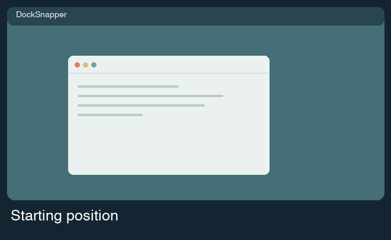

# DockSnapper

Snap the focused Mac window with four keyboard shortcuts. Hover over a running app in the Dock to see its windows, then click a thumbnail to bring that window forward.

| Shortcut | Action |
| --- | --- |
| Command + Shift + Left | Left half of the current display |
| Command + Shift + Right | Right half |
| Command + Shift + Up | Fill the usable desktop |
| Command + Shift + Down | Restore the window's position and size before its first snap |

Each window remembers its own original bounds for the current app session. Snapping respects the menu bar, Dock, and application minimum sizes. Full-screen windows are skipped. If a display has been unplugged, restore fits the window onto an available display.



## Build and run

Use a Mac with Xcode 16 or newer and its command-line tools selected. The build targets macOS 14 or later and compiles for the architecture of the build machine.

```sh
git clone https://github.com/bmeyers22/DockSnapper.git
cd DockSnapper
scripts/test.sh
scripts/build.sh
open build/DockSnapper.app
```

For daily use, move the app into Applications before granting permissions. Open the split-window menu bar icon and choose **Keyboard Shortcuts…** to edit any of the four actions. Click its current shortcut, then press a modifier and a key. Escape cancels. **Restore Defaults** returns all four to Command + Shift + Arrow. You can also pause snapping or toggle Dock thumbnails from the menu.

## Permissions and previews

- **Accessibility** lets DockSnapper identify the Dock icon under the pointer and move, resize, or raise the selected window. Choose **Enable Accessibility** during setup.
- **Screen & System Audio Recording** lets ScreenCaptureKit take window snapshots. Choose **Enable Window Images** from the menu, allow DockSnapper in System Settings, and reopen the app if macOS requests it. DockSnapper captures window images locally while a preview is open. It does not record audio, save screenshots, or send them anywhere.

Previews are snapshots taken when the panel opens. When a minimized, protected, or otherwise unavailable window has no usable image, the panel displays the app icon and window title. The panel lists the windows each app exposes through Accessibility. Some apps and Spaces configurations limit which windows macOS exposes or allows to be raised.

## Try it

Open two Finder windows at different sizes. Snap the first left, the second right, then restore each. Each should return to its own starting position. Hover over Finder in the Dock and choose the background window. Repeat with the Dock on another edge or display if that is your setup.

## License

MIT. See [LICENSE](LICENSE).
